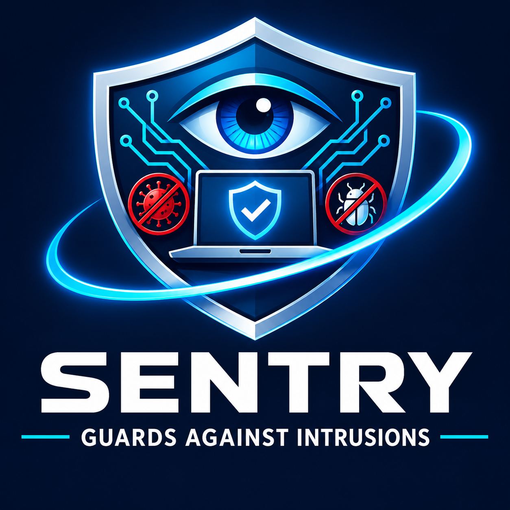

<p align="center">
  
</p>

<h1 align="center">SENTRY — Guards Against Intrusions</h1>
<p align="center"><b>Detect. Defend. Restore.</b></p>

SENTRY turns AI coding agents into careful cybersecurity operators. It has three parts:

| Part | What it is |
|---|---|
| **Universal AI skill** ([`SKILL.md`](SKILL.md) + [`agents/`](agents/) + [`workflows/`](workflows/) + [`policies/`](policies/)) | Teaches Claude Code, Codex, OpenCode, Cursor, Windsurf, Copilot, Gemini CLI, Cline, Roo Code, Aider (and generic agents) to orchestrate a scan, fan out specialised investigation sub-agents, explain every threat and drive human-approved remediation. |
| **SENTRY security engine** ([`sentry_engine/`](sentry_engine/)) | The trusted executor: filesystem scanner, YARA, ClamAV, Microsoft Defender corroboration, hash intelligence, static PE/script/macro/PDF/LNK analysis, archive inspection, process/network/ransomware behaviour, persistence inspection (Windows/Linux/macOS), configuration & dependency vulnerabilities, threat intelligence, a ten-agent orchestrator with an adaptive worker pool, cryptographic approvals, an encrypted quarantine, repair, recovery and verification. CLI, MCP server and REST API. |
| **SENTRY desktop app** ([`desktop/`](desktop/)) | React + Tauri application: Overview, Full/Quick/Custom Scan, Threat Center (✅ tick-to-approve), AI Investigation, Quarantine, System Repair, Agent Control Center, Scan History, Settings. |

> **The golden rule:** nothing is quarantined, deleted, disabled or repaired until **you** tick it and
> approve it with your approver passphrase. AI agents can scan, investigate, explain and execute
> *your* signed approvals. They cannot approve, by design and by cryptography.

---

## How it works

```
 you ─── "scan my PC" ──► coding agent + SENTRY skill
                              │  sentry_start_scan (MCP) / sentry scan (CLI)
                              ▼
                     SENTRY master coordinator ── adaptive worker pool (4–8 → up to 512)
                              │   10 capability-restricted engine agents
                              ▼
     YARA · ClamAV · Defender · hash intel · static analysis · archives · processes · network
     persistence · ransomware heuristics · config checks · OSV/Trivy · VirusTotal/abuse.ch (opt-in)
                              ▼
              evidence correlation → risk classification → explained report
                              ▼
   coding agent fans out LLM sub-agents per finding category → AI notes on each finding
                              ▼
   YOU tick ✅ findings in `sentry approve` or the desktop Threat Center + type your passphrase
                              ▼   Ed25519-signed, single-use, 30-min, path+SHA-256-bound approvals
          remediation executor: re-validate → quarantine (AES-256-GCM) / remove startup entry /
          repair (SFC, DISM, Defender, package managers) → verification agent → final report
                              ▼
                  tamper-evident audit log (hash chain) of every step
```

Every finding states its **category** (confirmed malware, suspected malware, suspicious behaviour,
unverified, vulnerability, configuration weakness, false positive), **severity**, **detection
engines**, **evidence**, **confidence and its limitations**, **MITRE ATT&CK techniques**, a
plain-language **explanation**, the **potential danger** and the **recommended action**.

## Quick start

```bash
# 1. install the engine (Python 3.11+)
git clone https://github.com/Tayane225/SENTRY && cd SENTRY
pip install -e ".[full]"            # adds yara-python; ClamAV is optional but recommended

# 2. YOU create the approver passphrase (interactive terminal only — never give it to an AI)
sentry init

# 3. check engines
sentry doctor

# 4. try it safely with the harmless SENTRY test signature
sentry test-file ./sentry-demo
sentry scan custom ./sentry-demo
sentry approve            # tick findings, choose actions, enter your passphrase
sentry verify
```

Connect your coding agent:

```bash
python scripts/install_skill.py --agent claude          # or codex, opencode, cursor, windsurf, copilot,
claude mcp add --scope user sentry -- sentry mcp         #    gemini, cline, roo, aider, generic, all
```

Then ask: *"Use SENTRY to check my computer for viruses."* See [`adapters/`](adapters/) for each agent.

Desktop app:

```bash
sentry serve --open                       # browser UI, no build tools needed (after `npm run build` in desktop/)
cd desktop && npm install && npm run tauri build   # native installer (needs Rust + WebView2/WebKitGTK)
```

## CLI overview

| Command | Who | Purpose |
|---|---|---|
| `sentry doctor` / `drives` | anyone | engines, privileges, drive scope |
| `sentry scan quick\|full\|custom PATH… [--online] [--workers N] [--max-workers N] [--json]` | anyone | scan (non-destructive) |
| `sentry findings / show / report [--format md\|html\|json]` | anyone | results with explanations |
| `sentry annotate FINDING --text …` | agents | record AI investigation notes (advisory) |
| `sentry approve [SCAN] [--findings …] [--action …]` | **human** | tick ✅ and sign approvals with the passphrase |
| `sentry remediate [SCAN]` | anyone | execute **already approved** actions, then verify |
| `sentry verify SCAN` | anyone | independent verification + rescan of affected folders |
| `sentry quarantine list` / `restore` / `delete` | list: anyone · restore/delete: **human** | vault management |
| `sentry repair plan` / `run STEP` | plan: anyone · run: **human** | SFC, DISM, Defender, firewall/UAC/SMBv1/RDP, packages |
| `sentry recovery list` / `rollback` | rollback: **human** | undo a persistence removal |
| `sentry monitor` / `schedule add` | anyone | continuous protection (alerts only) / scheduled scans |
| `sentry audit verify` | anyone | check the audit hash chain |
| `sentry mcp` / `sentry serve` | — | MCP server for agents / local API + UI |

## Security model (short)

* **Approver key:** Ed25519. The private key is encrypted with scrypt + AES-256-GCM under your
  passphrase and pinned by fingerprint. Wrong passphrases are rate-limited.
* **Approvals:** single-use, expire after 30 min (configurable 1 min–24 h), bound to finding +
  action + path + SHA-256 (or startup-entry fingerprint or repair-command hash). The target is
  re-validated immediately before execution. A changed file, link swap, replay, forgery or
  retargeting is rejected (covered by the security tests).
* **No agent can modify the system:** the MCP and CLI surfaces have no approve tool. Engine agents
  get capability-scoped services, and destructive capabilities do not exist in the broker.
* **Quarantine before delete:** encrypted vault, read-back verification, restore, separately
  approved permanent deletion, never for protected OS or security files.
* **Prompt-injection safe:** scanned content is data. Output is sanitised (bidi, control and ANSI
  characters escaped) and labelled untrusted.
* **Coexistence:** SENTRY never disables existing antivirus. On Windows it asks Defender for a
  second opinion with remediation disabled.

Full details: [docs/SECURITY_MODEL.md](docs/SECURITY_MODEL.md) · Architecture and plan:
[docs/ARCHITECTURE.md](docs/ARCHITECTURE.md) · Honest feature status:
[docs/LIMITATIONS.md](docs/LIMITATIONS.md).

## Testing

```bash
pip install -e ".[dev]"
pytest              # unit, integration, security, adversarial, performance
```

The test-suite uses the harmless EICAR file and a SENTRY-specific harmless test signature. It
never uses live malware. See [docs/TESTING.md](docs/TESTING.md) for the VM lab procedure.

## Documentation

[Install](docs/INSTALL.md) · [Configuration](docs/CONFIGURATION.md) · [API & MCP](docs/API.md) ·
[Agent integrations](adapters/) · [Testing](docs/TESTING.md) · [Deployment](docs/DEPLOYMENT.md) ·
[Security model](docs/SECURITY_MODEL.md) · [Limitations](docs/LIMITATIONS.md) ·
[Contributing](CONTRIBUTING.md) · [Security policy](SECURITY.md) · [Changelog](CHANGELOG.md)

## License

MIT. See [LICENSE](LICENSE). SENTRY integrates third-party engines (ClamAV, YARA, Microsoft
Defender, OSV, Trivy, VirusTotal, abuse.ch) under their own licences and terms.

---

<p align="center"><b>SENTRY — GUARDS AGAINST INTRUSIONS.</b><br><b>DETECT. DEFEND. RESTORE.</b></p>
